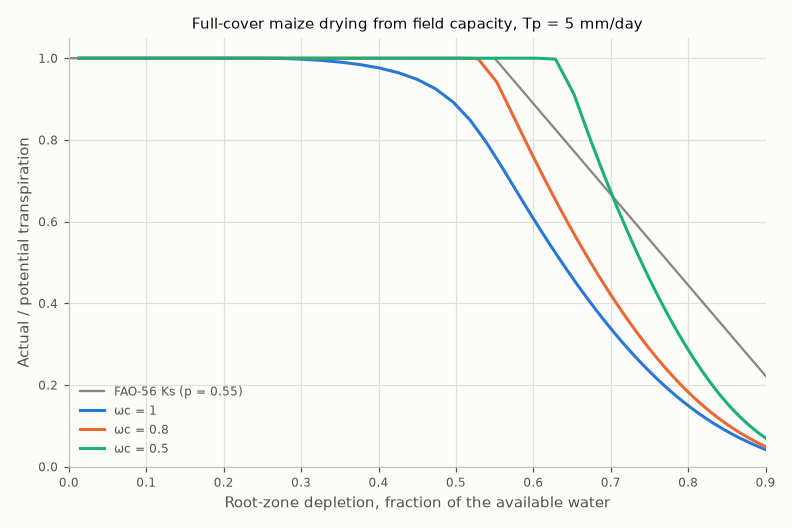
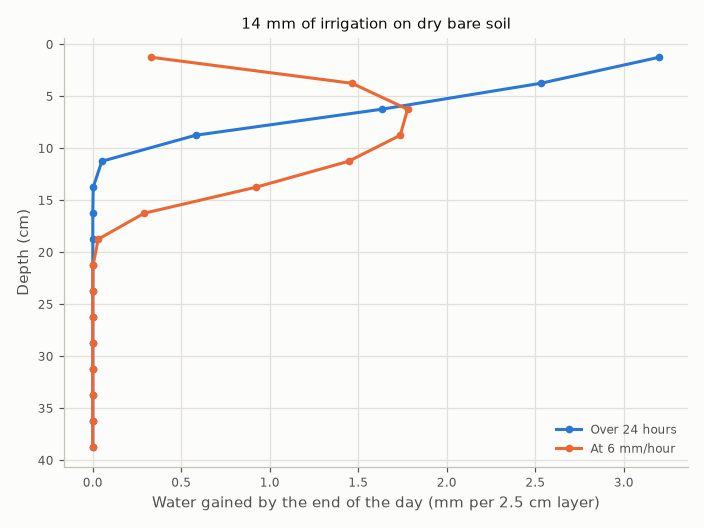

# Field model: root water uptake and irrigation

Generated by `python -m fao_model.field_model_report` on 2026-11-12.

Two settings of the field model decide how much a well-irrigated crop is stressed. This report shows the experiments behind them.

- **Compensated root water uptake** (Jarvis, 1989; Šimůnek and Hopmans, 2009), ωc = 0.8. Roots take water where the Feddes function allows it; ω, the root-weighted mean of the Feddes factor, measures the stress of the whole root zone. While ω ≥ ωc the roots in favourable layers make up for stressed ones and transpiration stays potential; below, it is ω/ωc of potential. ωc = 1 is uptake without compensation, as in versions 03-06.
- **Irrigation at 6 mm/hour** from the start of the day instead of spread over all of it.

## 1. When does a drying root zone start to stress the crop?

A full-cover root zone (1.2 m, loam) dries from field capacity without rain. The table gives the depletion at which transpiration falls below 95 % of potential, and Ta/Tp at given depletions. FAO-56 keeps transpiration potential until the depletion reaches p and then lowers it linearly to zero at the wilting point (Ks).

Potential transpiration 5 mm/day (FAO-56 p = 0.55):

| ωc | Stress from depletion | Ta/Tp at 0.3 | Ta/Tp at 0.4 | Ta/Tp at 0.5 | Ta/Tp at 0.6 | Ta/Tp at 0.7 | Ta/Tp at 0.8 |
|---|---|---|---|---|---|---|---|
| 1 (no compensation) | 0.45 | 1.00 | 0.98 | 0.89 | 0.61 | 0.34 | 0.15 |
| 0.9 | 0.53 | 1.00 | 1.00 | 0.98 | 0.67 | 0.37 | 0.16 |
| 0.8 (used here) | 0.55 | 1.00 | 1.00 | 1.00 | 0.76 | 0.42 | 0.18 |
| 0.7 | 0.60 | 1.00 | 1.00 | 1.00 | 0.87 | 0.48 | 0.21 |
| 0.6 | 0.63 | 1.00 | 1.00 | 1.00 | 0.98 | 0.56 | 0.24 |
| 0.5 | 0.65 | 1.00 | 1.00 | 1.00 | 1.00 | 0.67 | 0.29 |
| FAO-56 | 0.55 | 1.00 | 1.00 | 1.00 | 0.89 | 0.67 | 0.44 |

Potential transpiration 8 mm/day (FAO-56 p = 0.43):

| ωc | Stress from depletion | Ta/Tp at 0.3 | Ta/Tp at 0.4 | Ta/Tp at 0.5 | Ta/Tp at 0.6 | Ta/Tp at 0.7 | Ta/Tp at 0.8 |
|---|---|---|---|---|---|---|---|
| 1 (no compensation) | 0.47 | 1.00 | 0.97 | 0.88 | 0.60 | 0.33 | 0.14 |
| 0.9 | 0.55 | 1.00 | 1.00 | 0.96 | 0.66 | 0.36 | 0.15 |
| 0.8 (used here) | 0.55 | 1.00 | 1.00 | 1.00 | 0.74 | 0.41 | 0.17 |
| 0.7 | 0.59 | 1.00 | 1.00 | 1.00 | 0.85 | 0.47 | 0.20 |
| 0.6 | 0.63 | 1.00 | 1.00 | 1.00 | 0.96 | 0.54 | 0.23 |
| 0.5 | 0.67 | 1.00 | 1.00 | 1.00 | 0.99 | 0.65 | 0.27 |
| FAO-56 | 0.43 | 1.00 | 1.00 | 0.88 | 0.70 | 0.53 | 0.35 |

- **Without compensation** transpiration falls below 95 % at 45% depletion (5 mm/day), before the 55% irrigation trigger: the upper root zone, where most roots are, dries first.
- **With ωc = 0.8** it does so at 55%, against a FAO-56 p of 0.55 for that demand, so the Richards field and the FAO-56 bucket model agree on when stress begins. No value of ωc is tabulated for crops; it is chosen here for that agreement. Below the threshold the decline is steeper than FAO-56's straight line.

## 2. Where does a small irrigation go?

14 mm of irrigation, a typical early-season refill, on bare loam at 55% depletion, with 6 mm/day of potential evaporation that day and the six dry days after:

| Irrigation | Gain in the top 5 cm after the first day (mm) | Wetting front (cm) | Evaporation, first day (mm) | Evaporation, 7 days (mm) | Left in the soil (mm) |
|---|---|---|---|---|---|
| Over 24 hours | 5.7 | 12.5 | 6.0 | 14.3 | -0.4 |
| At 6 mm/hour | 1.8 | 17.5 | 6.0 | 12.4 | +1.6 |

Spread over the whole day, irrigation behaves like a day-long drizzle: the water stays in the top few centimetres, where evaporation takes it back. Applied in a few hours, it soaks deeper and more of it stays. 6 mm/hour is two thirds of this soil's saturated conductivity (9 mm/hour), so it infiltrates without runoff.

## 3. The irrigated maize field

The irrigated field of the water balance report, 1995-01-01 to 2024-12-31, with each setting switched on and off. Season means:

| Field model | Ta/Tp | Ta/Tp on irrigation days and the day after | Irrigation (mm) | Irrigations | Soil evaporation (mm) | Drainage (mm) | Runoff (mm) | Ya/Yx |
|---|---|---|---|---|---|---|---|---|
| As in 06: all day, no compensation | 0.924 | 0.77 | 821 | 14.5 | 205 | 7 | 0 | 0.83 |
| 6 mm/hour, no compensation | 0.926 | 0.78 | 781 | 12.5 | 168 | 6 | 0 | 0.84 |
| All day, ωc = 0.8 | 0.979 | 0.87 | 865 | 15.1 | 209 | 7 | 0 | 0.94 |
| 6 mm/hour, ωc = 0.8 (used now) | 0.982 | 0.88 | 824 | 13.1 | 169 | 6 | 0 | 0.95 |

- **Compensation removes most of the stress between irrigations**, so the field needs a little more water but uses it for transpiration.
- **Timed irrigation** wets the soil deeper and loses less to evaporation early in the season; the stress right after irrigation, the Feddes function's oxygen stress in the wet top layers, remains.
- The yield report and the water balance report use the settings marked "used now".
