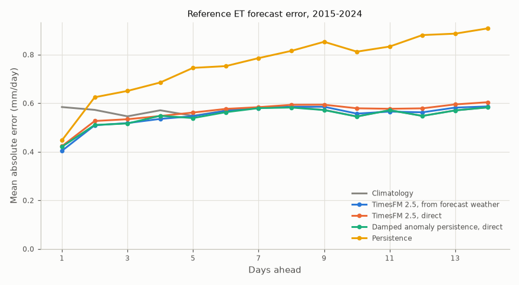
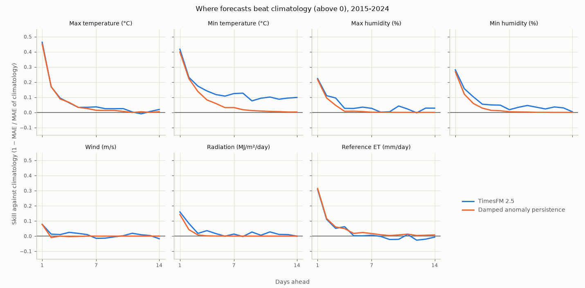
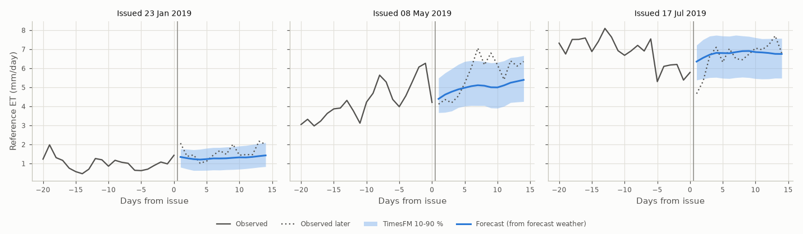

# Forecast skill: weather and reference ET

Generated by `python -m fao_model.forecast_skill` on 2026-10-13.

- Data: Konya Plain (Cumra), Turkiye; forecasts issued every 7 days for 2015-01-01 to 2024-12-25 (520 forecasts, 1-14 days ahead), each using only data up to its issue day.
- **TimesFM 2.5** (200M, zero-shot) forecasts each weather variable from its last 1024 days; reference ET is then computed from the forecast weather with ASCE-PM. It also forecasts the ETo series directly ("direct").
- **Damped anomaly persistence**: climatology plus today's anomaly shrinking by its lag-1 autocorrelation each day; this is the model's fallback without TimesFM.
- **Persistence**: every coming day equals today. **Climatology**: the smoothed day-of-year mean of 1995-2014.
- Skill = 1 − MAE / MAE of climatology: above 0 beats climatology, 1 is perfect.

## 1. Reference ET

Mean absolute error (mm/day) by days ahead, and of the 7-day total (mm), which matters for planning irrigation.

| Method | 1 day | 3 days | 7 days | 14 days | 7-day total |
|---|---|---|---|---|---|
| Climatology | 0.58 | 0.55 | 0.58 | 0.58 | 2.9 |
| TimesFM 2.5, from forecast weather | 0.40 | 0.52 | 0.58 | 0.59 | 2.5 |
| TimesFM 2.5, direct | 0.42 | 0.53 | 0.58 | 0.60 | 2.7 |
| Damped anomaly persistence, from forecast weather | 0.40 | 0.51 | 0.57 | 0.58 | 2.5 |
| Damped anomaly persistence, direct | 0.42 | 0.52 | 0.58 | 0.58 | 2.6 |
| Persistence | 0.45 | 0.65 | 0.79 | 0.91 | 3.8 |

## 2. Skill by variable

Skill against climatology at 1, 3, 7 and 14 days ahead. Rain is left out here: on a dry climate the absolute error rewards forecasting the median, which is 0 on most days, so it would make any median forecast look skilful; section 3 scores rain as amounts and events.

| Variable | Method | 1 day | 3 days | 7 days | 14 days |
|---|---|---|---|---|---|
| Max temperature (°C) | TimesFM 2.5 | +0.46 | +0.09 | +0.04 | +0.02 |
| Max temperature (°C) | Damped anomaly persistence | +0.45 | +0.09 | +0.01 | +0.00 |
| Min temperature (°C) | TimesFM 2.5 | +0.42 | +0.17 | +0.12 | +0.10 |
| Min temperature (°C) | Damped anomaly persistence | +0.40 | +0.14 | +0.03 | +0.00 |
| Max humidity (%) | TimesFM 2.5 | +0.22 | +0.10 | +0.03 | +0.03 |
| Max humidity (%) | Damped anomaly persistence | +0.22 | +0.05 | +0.00 | +0.00 |
| Min humidity (%) | TimesFM 2.5 | +0.28 | +0.10 | +0.02 | +0.00 |
| Min humidity (%) | Damped anomaly persistence | +0.27 | +0.06 | +0.00 | +0.00 |
| Wind (m/s) | TimesFM 2.5 | +0.08 | +0.01 | -0.02 | -0.02 |
| Wind (m/s) | Damped anomaly persistence | +0.08 | +0.00 | +0.00 | -0.00 |
| Radiation (MJ/m²/day) | TimesFM 2.5 | +0.16 | +0.02 | +0.01 | -0.00 |
| Radiation (MJ/m²/day) | Damped anomaly persistence | +0.14 | +0.01 | +0.00 | +0.00 |
| Reference ET (mm/day) | TimesFM 2.5 | +0.31 | +0.05 | +0.01 | -0.01 |
| Reference ET (mm/day) | Damped anomaly persistence | +0.31 | +0.06 | +0.02 | +0.01 |

## 3. Rain in the next three days

Expected rain over the next 3 days against what fell; an event is at least 10 mm (the irrigation rule's threshold). 32 of 520 forecast periods had an event. TimesFM and the anomaly baseline use their expected (mean) rain here, not the median.

| Method | MAE (mm) | RMSE (mm) | Events caught | False alarms |
|---|---|---|---|---|
| Climatology | 2.6 | 4.2 | 0 of 32 | 0 |
| TimesFM 2.5 | 2.2 | 4.2 | 0 of 32 | 0 |
| Damped anomaly persistence | 2.5 | 4.1 | 0 of 32 | 0 |
| Persistence | 3.3 | 7.4 | 6 of 32 | 36 |

## 4. TimesFM uncertainty

Share of days on which the observed reference ET fell inside TimesFM's 10-90 % interval of the direct forecast; a calibrated interval holds 80 %.

| | 1 day | 3 days | 7 days | 14 days |
|---|---|---|---|---|
| Inside the interval | 84% | 83% | 78% | 78% |

## 5. How much history does TimesFM need?

Direct reference ET forecast with different amounts of history (MAE, mm/day).

| History (days) | 1 day | 3 days | 7 days | 14 days |
|---|---|---|---|---|
| 512 | 0.42 | 0.54 | 0.60 | 0.63 |
| 1024 | 0.42 | 0.53 | 0.58 | 0.60 |
| 2048 | 0.42 | 0.53 | 0.58 | 0.60 |
