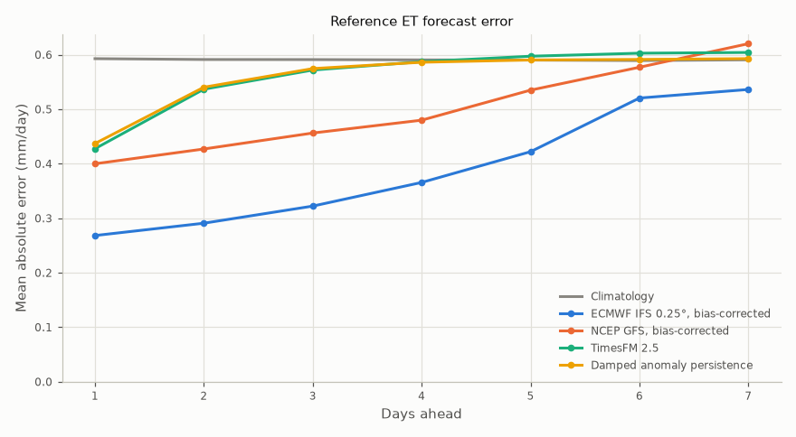
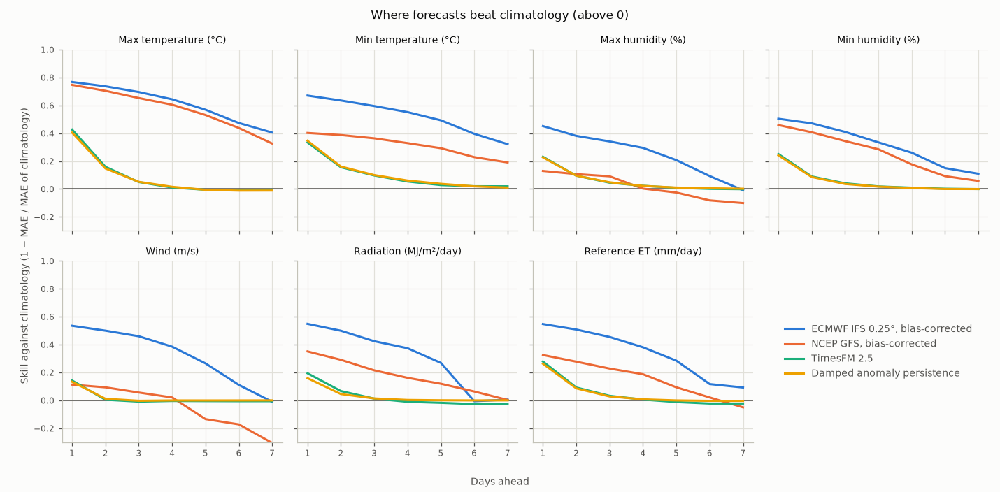
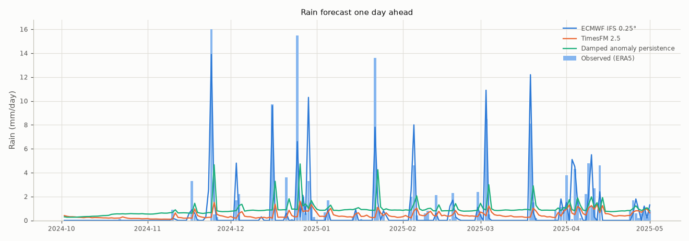

# Weather-model forecasts against TimesFM

Generated by `python -m fao_model.nwp_skill` on 2026-10-15.

- Site: Konya Plain (Cumra), Turkiye. Forecasts issued every evening from 2024-04-30 to 2026-09-23 (864 forecasts) for the next 1-7 days, compared with ERA5 observations up to 2026-09-30.
- **Weather models (NWP)**: ECMWF IFS 0.25° and NCEP GFS from Open-Meteo's Previous Runs API: for each hour, the value forecast 24 × lead hours earlier, aggregated to daily weather like the observations. Reference ET is computed from the forecast weather with ASCE-PM.
- **Bias-corrected**: minus a running bias (decaying average with weight 0.05, about 20 days of memory) of each variable and lead, using only the forecast-observation pairs known on the issue day; rain is not corrected. The archive starts in mid-March 2024, so scoring starts on 2024-05-01 after a warm-up.
- **TimesFM 2.5**, **damped anomaly persistence**, **climatology** (1995-2023) and **persistence** as in the forecast skill report.
- Caveat: ERA5, the observations here, is made by ECMWF with a model close to IFS, which may favour ECMWF over GFS.

## 1. Reference ET

Mean absolute error (mm/day) by days ahead, and of the 7-day total (mm).

| Method | 1 day | 3 days | 5 days | 7 days | 7-day total |
|---|---|---|---|---|---|
| Climatology | 0.59 | 0.59 | 0.59 | 0.59 | 2.8 |
| Persistence | 0.48 | 0.71 | 0.80 | 0.84 | 4.1 |
| Damped anomaly persistence | 0.44 | 0.57 | 0.59 | 0.59 | 2.6 |
| TimesFM 2.5 | 0.43 | 0.57 | 0.60 | 0.60 | 2.7 |
| ECMWF IFS 0.25°, raw | 0.31 | 0.36 | 0.47 | 0.62 | 2.2 |
| ECMWF IFS 0.25°, bias-corrected | 0.27 | 0.32 | 0.42 | 0.54 | 1.7 |
| NCEP GFS, raw | 0.53 | 0.59 | 0.69 | 0.76 | 3.7 |
| NCEP GFS, bias-corrected | 0.40 | 0.46 | 0.53 | 0.62 | 2.0 |

## 2. Systematic errors of the raw weather models

Mean of forecast − observation, which the bias correction removes as it learns it.

| Variable | ECMWF IFS 0.25°, 1 day | ECMWF IFS 0.25°, 7 days | NCEP GFS, 1 day | NCEP GFS, 7 days |
|---|---|---|---|---|
| Max temperature (°C) | -0.71 | -0.31 | -1.34 | -0.55 |
| Min temperature (°C) | -1.29 | -0.25 | +0.24 | +0.00 |
| Max humidity (%) | +4.54 | -0.42 | -0.90 | -1.32 |
| Min humidity (%) | -1.12 | -2.22 | +0.50 | -1.30 |
| Wind (m/s) | -0.01 | -0.07 | +0.80 | +0.66 |
| Radiation (MJ/m²/day) | +0.56 | +1.62 | +0.97 | +1.11 |
| Rain (mm/day) | +0.11 | +0.02 | -0.07 | -0.55 |

## 3. Skill by variable

Skill against climatology at 1, 3 and 7 days ahead (rain is scored in section 4).

| Variable | Method | 1 day | 3 days | 7 days |
|---|---|---|---|---|
| Max temperature (°C) | ECMWF IFS 0.25°, bias-corrected | +0.77 | +0.70 | +0.41 |
| Max temperature (°C) | NCEP GFS, bias-corrected | +0.75 | +0.65 | +0.33 |
| Max temperature (°C) | TimesFM 2.5 | +0.43 | +0.05 | -0.00 |
| Max temperature (°C) | Damped anomaly persistence | +0.40 | +0.05 | -0.01 |
| Min temperature (°C) | ECMWF IFS 0.25°, bias-corrected | +0.67 | +0.60 | +0.32 |
| Min temperature (°C) | NCEP GFS, bias-corrected | +0.40 | +0.36 | +0.19 |
| Min temperature (°C) | TimesFM 2.5 | +0.33 | +0.10 | +0.02 |
| Min temperature (°C) | Damped anomaly persistence | +0.35 | +0.10 | +0.01 |
| Max humidity (%) | ECMWF IFS 0.25°, bias-corrected | +0.45 | +0.34 | -0.01 |
| Max humidity (%) | NCEP GFS, bias-corrected | +0.13 | +0.09 | -0.10 |
| Max humidity (%) | TimesFM 2.5 | +0.23 | +0.05 | -0.00 |
| Max humidity (%) | Damped anomaly persistence | +0.23 | +0.05 | +0.00 |
| Min humidity (%) | ECMWF IFS 0.25°, bias-corrected | +0.50 | +0.41 | +0.11 |
| Min humidity (%) | NCEP GFS, bias-corrected | +0.46 | +0.34 | +0.06 |
| Min humidity (%) | TimesFM 2.5 | +0.25 | +0.04 | -0.00 |
| Min humidity (%) | Damped anomaly persistence | +0.24 | +0.04 | -0.00 |
| Wind (m/s) | ECMWF IFS 0.25°, bias-corrected | +0.54 | +0.46 | -0.01 |
| Wind (m/s) | NCEP GFS, bias-corrected | +0.11 | +0.06 | -0.31 |
| Wind (m/s) | TimesFM 2.5 | +0.14 | -0.01 | -0.01 |
| Wind (m/s) | Damped anomaly persistence | +0.13 | -0.00 | +0.00 |
| Radiation (MJ/m²/day) | ECMWF IFS 0.25°, bias-corrected | +0.55 | +0.42 | +0.01 |
| Radiation (MJ/m²/day) | NCEP GFS, bias-corrected | +0.35 | +0.22 | +0.00 |
| Radiation (MJ/m²/day) | TimesFM 2.5 | +0.19 | +0.01 | -0.03 |
| Radiation (MJ/m²/day) | Damped anomaly persistence | +0.16 | +0.01 | -0.00 |
| Reference ET (mm/day) | ECMWF IFS 0.25°, bias-corrected | +0.55 | +0.45 | +0.09 |
| Reference ET (mm/day) | NCEP GFS, bias-corrected | +0.33 | +0.23 | -0.05 |
| Reference ET (mm/day) | TimesFM 2.5 | +0.28 | +0.03 | -0.02 |
| Reference ET (mm/day) | Damped anomaly persistence | +0.26 | +0.03 | -0.00 |

## 4. Rain

Wet day: at least 1 mm tomorrow (147 of 864 days). Rain event: at least 10 mm within the next 3 days (48 of 864 forecasts). TimesFM and the baseline use their expected (mean) rain.

| Method | Wet days caught | Wet-day false alarms | Events caught | Event false alarms | 3-day MAE (mm) |
|---|---|---|---|---|---|
| Climatology | 83 of 147 | 211 | 0 of 48 | 0 | 2.4 |
| Persistence | 58 of 147 | 90 | 6 of 48 | 57 | 3.3 |
| Damped anomaly persistence | 55 of 147 | 78 | 0 of 48 | 0 | 2.4 |
| TimesFM 2.5 | 43 of 147 | 50 | 0 of 48 | 0 | 2.2 |
| ECMWF IFS 0.25°, raw | 110 of 147 | 38 | 33 of 48 | 47 | 1.4 |
| ECMWF IFS 0.25°, bias-corrected | 110 of 147 | 38 | 33 of 48 | 47 | 1.4 |
| NCEP GFS, raw | 93 of 147 | 30 | 28 of 48 | 39 | 1.7 |
| NCEP GFS, bias-corrected | 93 of 147 | 30 | 28 of 48 | 39 | 1.7 |

## 5. What this means for irrigation

The water balance report (section 6) found that even a perfect 3-day rain forecast saves no irrigation water at this site in the maize season, because rain is rare then. Better forecasts cannot beat that bound, so the irrigation rule is not rerun with these models.
