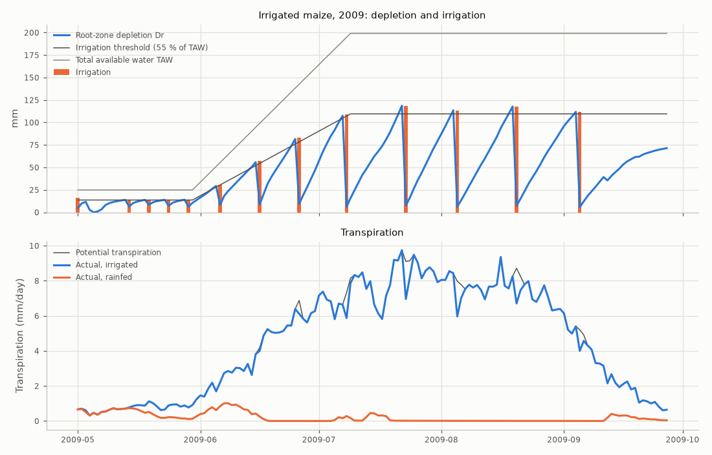
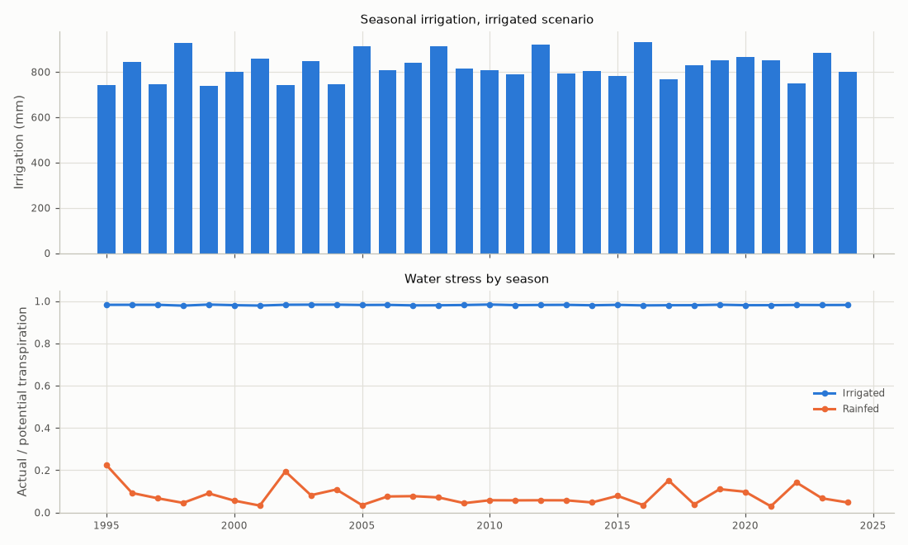
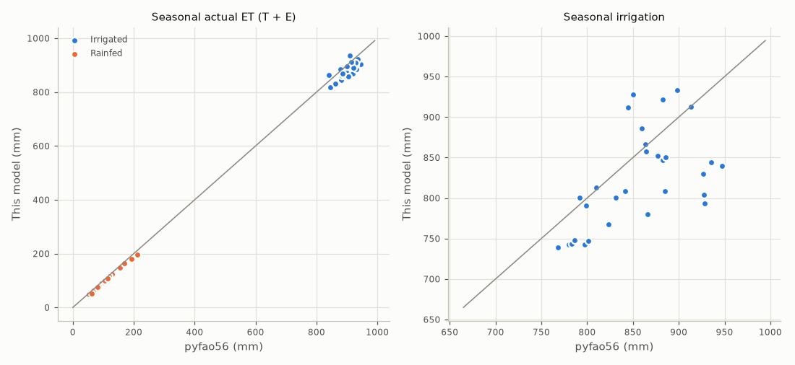
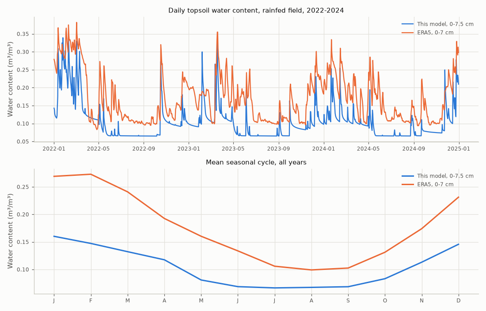

# Crop water balance: grain maize

Generated by `python -m fao_model.water_balance` on 2026-11-12.

- Weather: Konya Plain (Cumra), Turkiye, 1995-01-01 to 2024-12-31 (30 seasons); reference ET from this repo's daily ASCE-PM.
- Crop: grain maize planted on 01 May, stages 30/40/50/30 days, Kcb 0.15/1.236/0.15 (mid-season value adjusted to the site's wind and humidity, FAO-56 eq. 70), roots 0.15-1.2 m, height up to 2.0 m.
- Soil: loam (van Genuchten), 1.5 m column in 2.5 cm layers, free drainage at the bottom. Field capacity at -100 cm (θ = 0.227), wilting point θ = 0.061.
- ET: FAO-56 dual crop coefficients give potential transpiration (Kcb·ETo) and soil evaporation (Ke·ETo); the Richards solver limits both: roots take water through the Feddes stress function with compensation (ωc = 0.8), evaporation stops as the surface dries.
- Scenarios: **rainfed**, and **irrigated** whenever the root-zone depletion reaches 55% of the total available water, refilling the root zone to field capacity at 6 mm/hour.

## 1. Mean seasonal water balance

Season totals in mm (planting to harvest), averaged over all seasons. The first season starts from an assumed soil profile, the others from the simulated one.

| | Rainfed | Irrigated |
|---|---|---|
| Rain | 51 | 51 |
| Irrigation | 0 | 824 |
| Reference ET (ETo) | 885 | 885 |
| Potential transpiration | 722 | 722 |
| Actual transpiration | 57 | 709 |
| Potential soil evaporation | 398 | 398 |
| Actual soil evaporation | 41 | 169 |
| Drainage below 1.5 m | 1 | 6 |
| Runoff | 0 | 0 |
| Number of irrigations | 0.0 | 13.1 |
| Actual / potential transpiration | 0.08 | 0.98 |

## 2. Season by season

| Season | Rain | ETo | Rainfed T/Tp | Irrigation | Irrigations | Irrigated T/Tp | Irrigated T + E |
|---|---|---|---|---|---|---|---|
| 1995 | 64 | 858 | 0.22 | 743 | 12 | 0.98 | 831 |
| 1996 | 27 | 908 | 0.09 | 844 | 14 | 0.98 | 877 |
| 1997 | 96 | 854 | 0.07 | 747 | 12 | 0.98 | 844 |
| 1998 | 47 | 899 | 0.05 | 928 | 14 | 0.98 | 935 |
| 1999 | 57 | 846 | 0.09 | 739 | 13 | 0.98 | 828 |
| 2000 | 69 | 871 | 0.06 | 800 | 11 | 0.98 | 890 |
| 2001 | 60 | 918 | 0.03 | 857 | 13 | 0.98 | 912 |
| 2002 | 61 | 843 | 0.19 | 743 | 11 | 0.98 | 817 |
| 2003 | 49 | 892 | 0.08 | 847 | 13 | 0.98 | 888 |
| 2004 | 45 | 861 | 0.11 | 744 | 12 | 0.98 | 830 |
| 2005 | 23 | 878 | 0.03 | 912 | 15 | 0.98 | 884 |
| 2006 | 33 | 880 | 0.08 | 808 | 13 | 0.98 | 862 |
| 2007 | 21 | 934 | 0.08 | 839 | 14 | 0.98 | 903 |
| 2008 | 32 | 911 | 0.07 | 913 | 14 | 0.98 | 921 |
| 2009 | 53 | 865 | 0.04 | 813 | 13 | 0.98 | 863 |
| 2010 | 35 | 892 | 0.06 | 809 | 14 | 0.98 | 869 |
| 2011 | 58 | 846 | 0.06 | 791 | 11 | 0.98 | 864 |
| 2012 | 38 | 898 | 0.06 | 921 | 14 | 0.98 | 895 |
| 2013 | 21 | 913 | 0.06 | 793 | 13 | 0.98 | 868 |
| 2014 | 65 | 877 | 0.05 | 804 | 13 | 0.98 | 884 |
| 2015 | 47 | 872 | 0.08 | 780 | 13 | 0.98 | 858 |
| 2016 | 63 | 897 | 0.04 | 933 | 15 | 0.98 | 922 |
| 2017 | 48 | 901 | 0.15 | 768 | 12 | 0.98 | 873 |
| 2018 | 53 | 895 | 0.04 | 830 | 14 | 0.98 | 903 |
| 2019 | 52 | 879 | 0.11 | 853 | 14 | 0.98 | 858 |
| 2020 | 25 | 944 | 0.10 | 866 | 14 | 0.98 | 909 |
| 2021 | 41 | 901 | 0.03 | 850 | 15 | 0.98 | 890 |
| 2022 | 72 | 867 | 0.14 | 748 | 11 | 0.98 | 868 |
| 2023 | 80 | 874 | 0.07 | 886 | 13 | 0.98 | 911 |
| 2024 | 93 | 877 | 0.05 | 800 | 12 | 0.98 | 896 |

## 3. An example season (2009, median irrigation)

## 4. Comparison with pyfao56

pyfao56 implements the FAO-56 water balance as a bucket model: a two-stage evaporation layer (Ze = 0.10 m, REW = 9 mm) and a root zone whose transpiration falls linearly once depletion passes p·TAW. It was given the same weather, ETo, crop parameters, field capacity and wilting point, the same irrigation trigger, and on each planting day this model's soil water profile (5 cm layers). Season means in mm:

| | Rainfed, this model | Rainfed, pyfao56 | Irrigated, this model | Irrigated, pyfao56 |
|---|---|---|---|---|
| Transpiration | 57 | 63 | 709 | 697 |
| Soil evaporation | 41 | 41 | 169 | 203 |
| Irrigation | 0 | 0 | 824 | 855 |
| Number of irrigations | 0.0 | 0.0 | 13.1 | 15.0 |
| Drainage / deep percolation | 1 | 0 | 6 | 4 |

Season by season (this model − pyfao56):

| | Bias (mm) | Relative bias (%) | r |
|---|---|---|---|
| Actual ET, rainfed | -6 | -5.8 | 1.00 |
| Actual ET, irrigated | -22 | -2.4 | 0.77 |
| Irrigation, irrigated | -31 | -3.7 | 0.57 |

The season means agree closely. Single seasons differ more in irrigation because it comes as discrete refills of up to about 110 mm (55 % of the available water at full rooting depth): one refill more or less before harvest moves a season's total by that much. The remaining differences come from the model structure:

- irrigation here refills the root zone to field capacity, while pyfao56 also adds the day's estimated ET;
- transpiration stress here follows the Feddes function of the local pressure head, with compensation between layers, in pyfao56 a linear function of root-zone depletion;
- here water moves between layers by Richards flow and drains below the roots after each refill; pyfao56 drains instantly to field capacity.

Soil evaporation is 102% of pyfao56's in the rainfed field and 83% in the irrigated one, where irrigation at 6 mm/hour soaks below the evaporating top layers. It depends on the top layer's thickness: 5 cm layers gave about 30 % more than the 2.5 cm used here.

## 5. Topsoil water content against ERA5

The rainfed field's water content in the top 7.5 cm against ERA5's 0-7 cm soil moisture (a land-surface model with its own soil and vegetation, no irrigation). The soils differ, so the timing and the seasonal cycle matter more than the absolute level.

| Daily values | Bias (m³/m³) | RMSE (m³/m³) | r | r of monthly means |
|---|---|---|---|---|
| 10958 days | -0.072 | 0.086 | 0.80 | 0.97 |

## 6. Irrigation with rain forecasts (2015-2024)

Same irrigated field and trigger, but a due irrigation is postponed when at least 10 mm of rain is forecast for the next three days, unless 75 % of the available water is already used. Forecasts are issued the evening before; "perfect" knows the rain that fell and is the upper limit of what a forecast can save. All scenarios start from the same soil state on 1 January 2015. Season means:

| | No forecast | Perfect forecast | TimesFM 2.5 | Damped anomaly persistence |
|---|---|---|---|---|
| Irrigation (mm) | 831 | 816 | 831 | 831 |
| Number of irrigations | 13.3 | 13.2 | 13.3 | 13.3 |
| Postponed irrigation days | 0.0 | 0.3 | 0.0 | 0.0 |
| Actual / potential transpiration | 0.981 | 0.981 | 0.981 | 0.981 |
| Drainage below 1.5 m (mm) | 7.8 | 5.4 | 7.8 | 7.8 |
| Irrigations followed by ≥ 10 mm of rain within 3 days, all 10 seasons | 2 | 0 | 2 | 2 |

Rain of 10 mm or more within three days is rare in this season (see the forecast skill report), which bounds what forecast-based postponing can save at this site.