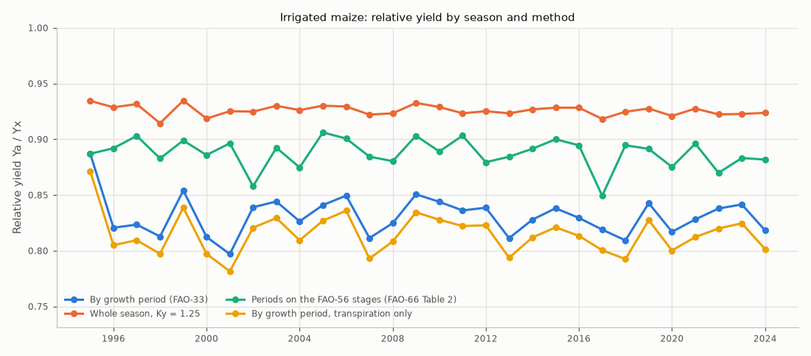
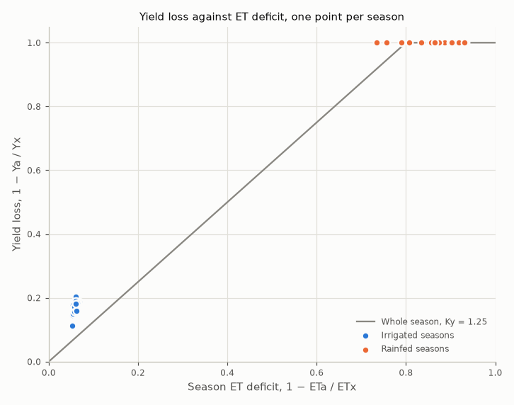

# Yield response to water: grain maize

Generated by `python -m fao_model.yield_report` on 2026-10-17.

- Weather: Konya Plain (Cumra), Turkiye, 1995-01-01 to 2024-12-31 (30 seasons).
- Fields: the rainfed and irrigated maize fields of the [water balance report](../water_balance/README.md) (FAO-56 dual crop coefficients over the Richards solver; irrigation refills the root zone at 55% depletion). The first season starts from an assumed soil profile, the others from the simulated one.
- Yield: the FAO-33 water production function (Doorenbos and Kassam, 1979; Steduto et al., 2012, FAO-66), 1 − Ya/Yx = Ky (1 − ETa/ETx). ETx is the crop ET with the crop's water needs met; with dual crop coefficients the deficit is in transpiration, so soil evaporation counts the same in both: ETx = Tp + Ea, ETa = Ta + Ea.
- Growth periods and their Ky (FAO-33 values for maize), combined by multiplying the periods' relative yields (Rao et al., 1988):

| Period | Days of the season | Ky | Placed on |
|---|---|---|---|
| Vegetative | 1-70 | 0.40 | initial and development stages |
| Flowering | 71-85 | 1.50 | first 15 days of mid-season (FAO-56: full cover at the initiation of flowering); the length is assumed |
| Yield formation | 86-120 | 0.50 | rest of mid-season |
| Ripening | 121-150 | 0.20 | late season |

The whole-season Ky is 1.25. FAO-66 warns that yields estimated this way carry large errors, so the results are best read as relative yield losses.

## 1. Relative yield

Mean Ya/Yx over the seasons by method (lowest and highest season in brackets):

| Method | Rainfed | Irrigated |
|---|---|---|
| By growth period (FAO-33) | 0.00 (0.00-0.00) | 0.83 (0.80-0.89) |
| Whole season, Ky = 1.25 | 0.00 (0.00-0.08) | 0.93 (0.91-0.93) |
| Periods on the FAO-56 stages (FAO-66 Table 2) | 0.01 (0.00-0.09) | 0.89 (0.85-0.91) |
| By growth period, transpiration only | 0.00 (0.00-0.00) | 0.81 (0.78-0.87) |

- **Rainfed maize fails at this site:** about 51 mm of rain falls in the season against 885 mm of reference ET, and the relative yield is 0.00.
- **The irrigated field still loses 17%** by growth period and 7% with the whole-season Ky. The largest loss is in the flowering period (Ky 1.50, section 2).
- **The placement of the periods matters:** with Ky placed on the FAO-56 stages, which puts the flowering value on the development stage, the mean is 0.89 instead of 0.83.

Points above the whole-season line lost more yield than their seasonal ET deficit suggests, because the deficit fell on sensitive periods.

## 2. Where the irrigated field loses yield

| Period | Ky | ETa / ETx | Relative yield of the period |
|---|---|---|---|
| Vegetative | 0.40 | 0.971 | 0.988 |
| Flowering | 1.50 | 0.928 | 0.892 |
| Yield formation | 0.50 | 0.907 | 0.954 |
| Ripening | 0.20 | 0.944 | 0.989 |

Why a field irrigated whenever it needs water is still stressed:

- **Just after irrigation.** Irrigation days and the day after make up 19% of the season but 46% of the transpiration deficit: Ta/Tp is 0.77 on those days against 0.95 on the others. The whole refill is applied in one day, which wets the top layers above -30 cm, where the Feddes function reduces uptake for lack of oxygen.
- **Before irrigation.** At high demand, uptake starts to fall once the head drops below -325 cm, which in this soil is 49% depletion, close to the 55% trigger. The top of the root zone, where most roots are, dries faster than the root-zone average, and uptake lost there is not made up from wetter, deeper layers.

The irrigated field run again without oxygen stress (Feddes h1 = h2 = 0 cm) shows how much of the loss comes from it:

| Irrigated field | Ta / Tp | Ta / Tp on irrigation days and the day after | Irrigation (mm) | Ya / Yx |
|---|---|---|---|---|
| As modelled | 0.924 | 0.77 | 821 | 0.83 |
| Without oxygen stress | 0.947 | 0.95 | 836 | 0.89 |

Both causes are properties of the field model rather than of the yield response: a daily time step with the whole refill on one day, and root water uptake without compensation.

## 3. Yield and water productivity

Absolute yields need the maximum yield Yx, assumed here to be 13 t/ha. For comparison, grain maize in Konya province averaged 12.65 t/ha in 2024 (TÜİK data in [Konya Tarım İstatistikleri](https://konya.tarimorman.gov.tr/Belgeler/kitap/konyatarimistilce2025.pdf), Konya Provincial Directorate of Agriculture and Forestry, 2025). All yields and water productivities below scale with Yx.

| Season | Rain (mm) | Irrigation (mm) | ETa / ETx | Ya / Yx | Yield (t/ha) | ET water productivity (kg/m³) | Irrigation water productivity (kg/m³) |
|---|---|---|---|---|---|---|---|
| 1995 | 64 | 790 | 0.948 | 0.89 | 11.5 | 1.37 | 1.46 |
| 1996 | 27 | 853 | 0.943 | 0.82 | 10.7 | 1.20 | 1.25 |
| 1997 | 96 | 817 | 0.945 | 0.82 | 10.7 | 1.27 | 1.31 |
| 1998 | 46 | 825 | 0.931 | 0.81 | 10.6 | 1.20 | 1.28 |
| 1999 | 57 | 803 | 0.948 | 0.85 | 11.1 | 1.31 | 1.38 |
| 2000 | 69 | 820 | 0.935 | 0.81 | 10.6 | 1.22 | 1.29 |
| 2001 | 60 | 853 | 0.940 | 0.80 | 10.4 | 1.14 | 1.21 |
| 2002 | 61 | 740 | 0.940 | 0.84 | 10.9 | 1.35 | 1.47 |
| 2003 | 49 | 863 | 0.944 | 0.84 | 11.0 | 1.25 | 1.27 |
| 2004 | 45 | 741 | 0.941 | 0.83 | 10.7 | 1.31 | 1.45 |
| 2005 | 23 | 889 | 0.944 | 0.84 | 10.9 | 1.23 | 1.23 |
| 2006 | 33 | 781 | 0.943 | 0.85 | 11.0 | 1.29 | 1.41 |
| 2007 | 21 | 928 | 0.938 | 0.81 | 10.5 | 1.14 | 1.14 |
| 2008 | 32 | 816 | 0.939 | 0.82 | 10.7 | 1.20 | 1.31 |
| 2009 | 53 | 875 | 0.946 | 0.85 | 11.1 | 1.25 | 1.26 |
| 2010 | 35 | 822 | 0.943 | 0.84 | 11.0 | 1.26 | 1.33 |
| 2011 | 58 | 789 | 0.939 | 0.84 | 10.9 | 1.29 | 1.38 |
| 2012 | 38 | 783 | 0.940 | 0.84 | 10.9 | 1.26 | 1.39 |
| 2013 | 21 | 877 | 0.939 | 0.81 | 10.5 | 1.18 | 1.20 |
| 2014 | 65 | 788 | 0.941 | 0.83 | 10.8 | 1.23 | 1.37 |
| 2015 | 47 | 876 | 0.943 | 0.84 | 10.9 | 1.23 | 1.24 |
| 2016 | 63 | 816 | 0.943 | 0.83 | 10.8 | 1.19 | 1.32 |
| 2017 | 48 | 767 | 0.935 | 0.82 | 10.6 | 1.24 | 1.39 |
| 2018 | 53 | 891 | 0.940 | 0.81 | 10.5 | 1.16 | 1.18 |
| 2019 | 52 | 827 | 0.942 | 0.84 | 11.0 | 1.26 | 1.32 |
| 2020 | 25 | 878 | 0.937 | 0.82 | 10.6 | 1.16 | 1.21 |
| 2021 | 41 | 830 | 0.942 | 0.83 | 10.8 | 1.21 | 1.30 |
| 2022 | 72 | 743 | 0.938 | 0.84 | 10.9 | 1.28 | 1.47 |
| 2023 | 80 | 777 | 0.938 | 0.84 | 10.9 | 1.25 | 1.41 |
| 2024 | 93 | 780 | 0.939 | 0.82 | 10.6 | 1.24 | 1.36 |
| Mean | | | | 0.83 | 10.8 | 1.24 | 1.32 |

- ET water productivity: yield per cubic metre of actual crop ET (transpiration and soil evaporation).
- Irrigation water productivity: the yield gained over the rainfed field per cubic metre of irrigation.
